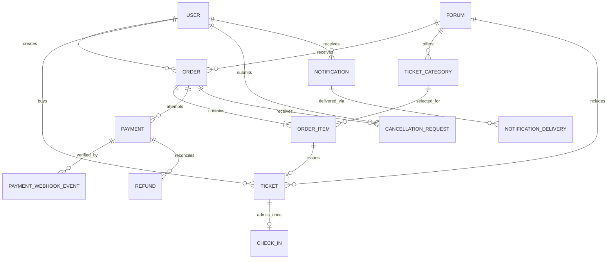

# FORUM.KG — Database Design

**Version:** 1.0 (implementation draft)  
**Database:** Neon Serverless PostgreSQL  
**ORM:** Prisma ORM 7  
**Backend:** NestJS + TypeScript  
**Currency:** KGS (prices/amounts stored in tyiyn, e.g. `1500 KGS = 150000`)  
**Time:** UTC timestamps; forum presentation in `Asia/Bishkek` by default  
**Locales:** `RU` (default), `KY`, `EN`

This package contains a concrete Prisma schema and a supplemental SQL migration for database-level checks. The schema is not a live Neon database: it must be migrated into your Neon project.

## 1. Files

| File | Description |
|---|---|
| `prisma/schema.prisma` | Complete relational schema with enums, relations and indexes |
| `prisma.config.ts` | Prisma ORM 7 CLI connection configuration |
| `.env.example` | Neon connection-string placeholders (no credentials) |
| `docs/invariants.sql` | Supplemental PostgreSQL `CHECK` constraints |
| `docs/implementation-notes.md` | Operational transactions, concurrency, payment/QR rules |

## 2. Core entity relationships



Each `Order` belongs to **one** forum and can contain several `OrderItem`s. Every `OrderItem` stores a participant's first name, last name, chosen category and immutable checkout price. A successfully paid item receives exactly one unique QR `Ticket`. A `Ticket` can have **at most one** successful `CheckIn` (the database enforces `CheckIn.ticketId @unique`).

> The schema supports orders with one or more tickets, including different categories. Partial ticket cancellation and refund behavior must be approved before implementing that workflow.

## 3. Tables / models

### Authentication and user accounts

| Model | Responsibility |
|---|---|
| `User` | Name, verified phone, optional email, role, locale, account state |
| `AuthIdentity` | Linked Google identity (unique provider subject) |
| `OtpChallenge` | Hashed, expiring phone verification codes |
| `TelegramConnection` | A linked Telegram chat per user |
| `PushSubscription` | Browser push subscriptions (unique endpoint hash) |

Google login **does not bypass mandatory phone verification**. User profiles may be incomplete while onboarding, but purchasing must require completed name and verified phone. Normalize all phone numbers to E.164 and emails to lowercase before storing.

### Event inventory

| Model | Responsibility |
|---|---|
| `Forum` | Forum schedule, status, venue, capacity, per-account limit, QR expiry |
| `ForumTranslation` | RU/KY/EN title, description and program |
| `TicketCategory` | Standard, VIP or custom category; price and capacity |
| `TicketCategoryTranslation` | Localized category name and description |

`Forum.maxTicketsPerAccount` defaults to **1** and can be changed per forum. Sold-out status should be **calculated** from available inventory; it is not a stored lifecycle status. A Russian translation must exist before publishing a forum.

### Orders, payments and admission

| Model | Responsibility |
|---|---|
| `Order` | Purchasing user, forum, amount, status and reservation expiry |
| `OrderItem` | One participant's ticket choice and price snapshot |
| `Payment` | Finik payment attempts and confirmation |
| `PaymentWebhookEvent` | Webhook deduplication and processing history |
| `Ticket` | Unique ticket number, encrypted QR token, token hash, status and expiry |
| `CheckIn` | Successful, single-use admission record |
| `CancellationRequest` | Admin-reviewed cancellation requests |
| `Refund` | Financial refund accounting; automation TBD |
| `OfflineAdmission` | Exceptional provisional entry based on a receipt during an outage |

**Do not issue a ticket solely on return to the payment page.** Verify payment server-side through authenticated Finik callbacks and/or verified provider status.

### Communications, configuration and audit

| Model | Responsibility |
|---|---|
| `Notification` | Inbox notification for each user |
| `NotificationDelivery` | Telegram / push delivery attempts, retry state |
| `SiteSettings` | Editable display name, colors, logo, contact details |
| `SiteSettingsTranslation` | RU/KY/EN landing content |
| `SocialLink` | Editable social media links |
| `IntegrationHealth` | Safe operational status without API credentials |
| `AuditLog` | Administrative actions and reviews |

## 4. Key business rules enforced by the backend

1. **Account cap:** Count non-cancelled issued tickets (including used tickets) **plus active held order items** for the selected forum. Do not count successfully cancelled tickets or expired reservations. Prevent transactions from racing by taking appropriate row locks.
2. **Capacity:** The forum total and optional ticket-category capacity must not be exceeded, including unexpired checkout holds.
3. **Confirmed purchases only:** An order may issue tickets only after an authentic, amount-matching Finik payment confirmation.
4. **One ticket per item:** `Ticket.orderItemId @unique`; retries cannot create a second ticket for the same item.
5. **Single-use QR:** `CheckIn.ticketId @unique` and atomic change of ticket state from `ACTIVE` to `USED`.
6. **Expiry:** Even if `Ticket.status = ACTIVE`, deny entry when `expiresAt <= now()`; expired is a **derived display state**.
7. **Ticket category immutable:** `OrderItem.ticketCategoryId` and `unitPriceMinor` are snapshots of the purchase and must not be edited after payment.
8. **Cancellation:** Submission alone does not invalidate tickets. After the approved cancellation is completed, affected ticket(s) become invalid, freeing the account limit as applicable. Financial refund is a separate workflow.
9. **Translations:** Default to Russian when localized content is missing.
10. **Payment + attendee:** The purchasing account (`Order.userId`) is separate from participant names (`OrderItem.participantFirstName`, `participantLastName`).

## 5. Neon + Prisma 7 setup

Use a current Node.js version and create a Neon database at https://console.neon.tech/.

```bash
pnpm add @prisma/client @prisma/adapter-neon dotenv
pnpm add -D prisma
```

1. Copy `prisma/schema.prisma` into your project at that path.
2. Copy the Prisma configuration file into the project root. Prisma 7.10+ projects may use `prisma7.config.ts` instead; **do not keep both configuration filenames**.
3. Copy `.env.example` to `.env` and set your actual Neon pooled (`DATABASE_URL`) and direct (`DIRECT_URL`) connection strings. **Never commit `.env`.**
4. Run:

```bash
pnpm prisma format
pnpm prisma validate
pnpm prisma migrate dev --name init_forum_kg
pnpm prisma generate
```

5. Include the statements in `docs/invariants.sql` in a **subsequent** Prisma SQL migration. Do not apply the file before Prisma creates the tables.
6. In production, apply committed migrations using `pnpm prisma migrate deploy`, not `migrate dev` or `db push`.
7. Configure the NestJS Prisma Client with the Neon adapter:

```ts
import { PrismaClient } from './generated/prisma/client';
import { PrismaNeon } from '@prisma/adapter-neon';

const adapter = new PrismaNeon({
  connectionString: process.env.DATABASE_URL!,
});
export const prisma = new PrismaClient({ adapter });
```

The import path for the generated client must be adjusted to your actual monorepo layout. NestJS can encapsulate the client inside a dedicated `PrismaService`.

**Connection separation:** runtime should use the Neon pooled connection; CLI migrations should use the direct connection. Store connection strings in a secrets manager for production.

Official reference: [Prisma 7 PostgreSQL/Neon documentation](https://www.prisma.io/docs/orm/v7/core-concepts/supported-databases/postgresql).

## 6. Not implemented by Prisma schema alone

A relational schema does **not** automatically implement account ticket limits, Finik authentication, background processing, safe token encryption, or distributed race protection. Those require backend services and transactional operations. See `docs/implementation-notes.md`.

## 7. Unconfirmed business decisions

- Whether cancellation is always an entire order or can target one ticket.
- Whether refund processing is automatic, manual, or mixed.
- Whether partial refunds and cancellation after check-in are supported.
- How QR expiration changes affect already issued tickets.
- Payment hold duration (10 minutes is a proposed default, not confirmed).
- The SMS provider and hosting platform.
- Detailed requirements for the optional AI service.

**Status:** Database design draft for implementation review. It does not contain real credentials or connect to a live Neon account.
